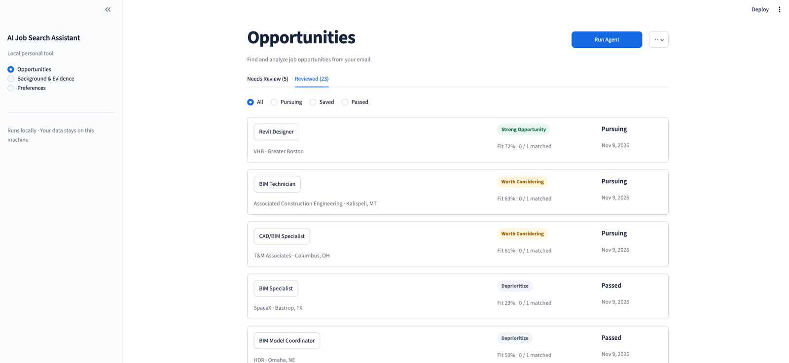
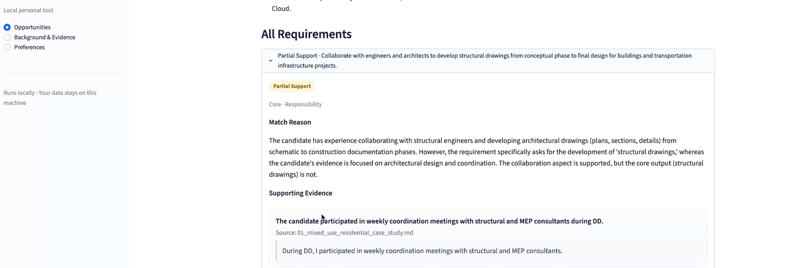
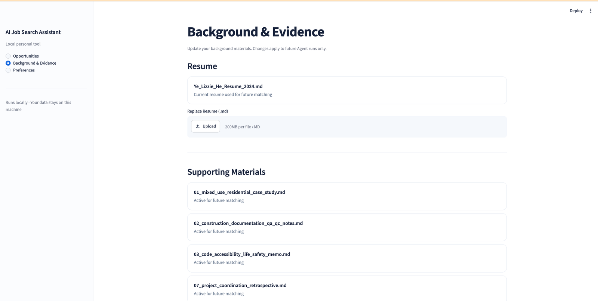

# AI Job Search Agent

**A working, end-to-end AI job-search assistant that transforms noisy job-alert emails into an explainable, evidence-grounded opportunity review queue.**

Built as a **local, single-user application** with Python, Streamlit, Gmail API, Qwen, and SQLite. The product is functional from Gmail ingestion through human review; it is not a hosted SaaS product, and its AI components have not been validated at production scale.

> **Portfolio V1 · AI product building · Human-in-the-loop decision support**
>
> The application helps a job seeker answer two different questions: **“How well does my evidence match this role?”** and **“Is this role worth pursuing?”** It presents the supporting evidence rather than asking users to trust an opaque AI-generated recommendation.

## Why I built it

I am transitioning from architectural design into AI and software after pursuing graduate study in computer science. During my own job search, I noticed that getting more job alerts did not solve the hardest part of the process. I still had to find a complete job description, interpret its requirements, compare them with my actual background and projects, and decide where to invest limited application time.

The problem was not just discovering opportunities; it was making **repeatable, evidence-based decisions** about them. I built this tool to automate the repetitive analysis while retaining the user's control over the final decision.

## The product at a glance

| | |
|---|---|
| **Primary user** | Job seekers, especially people changing careers or evaluating unfamiliar technical roles; initially designed for my own use |
| **Inputs** | Gmail job alerts, one active Markdown resume, optional supporting Markdown documents, and five optional job preferences |
| **Automated work** | Email triage; job-lead extraction; public JD search and verification; evidence and requirement extraction; matching; fit and priority calculation; durable saving |
| **User-facing output** | An opportunity queue, explicit requirements, strong matches, gaps, source-backed explanations, and a review history |
| **Human decision** | **Pass / Save for later / Pursue** |
| **Product boundary** | No automatic application submission, recruiter outreach, or resume customization in V1 |
| **Current status** | End-to-end runnable local application, with small offline component benchmarks and local regression tests—not production deployment or demonstrated large-scale user adoption |

### What the user experiences

1. **Onboard:** connect Gmail, add a Markdown resume, optionally add project documents, and set preferences.
2. **Run Agent:** the application processes recent alerts, finds usable job postings, and produces grounded analyses.
3. **Review opportunities:** compare prioritized jobs in a persistent **Needs Review** queue.
4. **Inspect the reasoning:** open a job to see each requirement, its support level, the explanation, and the original candidate evidence.
5. **Decide:** mark it **Pass**, **Save for later**, or **Pursue**. The analysis remains available for reference.

## Product walkthrough — running local application

These are screenshots of the **working Streamlit application**, captured during a real local session on November 9, 2026—not Figma mockups. The app connects candidate background materials to validated job postings and saves the resulting analysis for human review.

**Short demo video:** planned; not yet published. The walkthrough will show **Background & Evidence → Run Agent → Opportunities → Requirement Analysis → Pass / Save for later / Pursue**. The source code and local setup instructions are available below.

### 1. Review opportunities and decide what to pursue

The Opportunities view persists analyzed jobs in **Needs Review** and **Reviewed** queues. Each row shows the role and company, a requirement-fit signal, and a pursuit-priority tier; reviewed items retain their human decision. The numerical fit is a **weighted heuristic derived from supported requirements**, not the probability of getting an interview.

[](docs/screenshots/01-opportunities-review-queue.png)

### 2. Inspect *why* a requirement is supported—or only partially supported

Inside a job's **Requirement Analysis**, a user can expand a requirement to inspect the support level, a written match reason, and supporting claims alongside their source documents and original text. This inspectability matters because candidate evidence may be incomplete and model judgments can be wrong.

[](docs/screenshots/02-explainable-requirement-analysis.png)

### 3. Ground analysis in the user's own background

**Background & Evidence** manages one active Markdown resume and optional supporting project documents. These become validated evidence units for future matching. Keeping the background separate from each job posting makes the workflow reusable across roles.

[](docs/screenshots/03-background-and-evidence.png)

> **Demo scope and privacy:** Screenshots show a local test session. They do not establish model accuracy, broad user adoption, or cloud deployment. The application uses a real Gmail connection for job discovery, but Gmail tokens, secrets, messages, and the local candidate database are not published. Any future video should use sanitized or synthetic data.

## Product decisions and tradeoffs

Building a working workflow required more than connecting an LLM to Gmail. These decisions shaped the MVP:

| Product decision | Why it matters | Tradeoff / lesson |
|---|---|---|
| **Human-in-the-loop, not auto-apply** | A match score should support a person's career decision, not silently make it | Narrower automation scope, but more trust and user control |
| **Verify the full JD before scoring** | Job-alert summaries and protected job-board pages frequently omit requirements | Bounded web search can improve usable inputs, but introduces latency, cost, and external-site failure modes |
| **Make every judgment inspectable** | AI can overlook real experience or make a plausible but unsupported claim | Structured evidence, source citations, and a second check of negative conclusions add work but reveal errors |
| **Separate capability fit from preferences** | “Can I do this role?” is not the same as “Do I want this role?” | Deterministic weighted fit and a bounded preference adjustment are explainable; their thresholds still need calibration |
| **Use application-controlled orchestration** | Unbounded agent loops make cost, latency, and failure behavior hard to predict | Explicit stages, bounded searches, retries, and durable state give up some autonomy for reliability |
| **Save partial success** | A failed candidate should not erase previously analyzed jobs | More state-management complexity, but a more dependable user experience |

### An iteration driven by evidence

In a small live diagnostic, the initial direct-fetch approach produced **0/4 analysis-ready JDs** from four LinkedIn/Indeed provider links. Rather than asking the model to infer missing content, I redesigned JD resolution: LinkedIn/Indeed leads go to **bounded Web Search**, while other sources receive one direct-fetch attempt before search fallback. This is evidence for a specific design change, **not** a general success-rate benchmark. See the [architecture decision and historical protocol](docs/jd-resolution-decision.md).

## What I measured—and what I learned

I evaluated individual AI stages with curated, reviewed examples rather than claiming a single system-wide “AI accuracy” number.

| Component | Recorded evidence | What the result does / does not mean |
|---|---|---|
| **Discovery** | 9 cases (8 sanitized Gmail-derived + 1 synthetic regression); 9/9 case passes and email classification; 15/15 job-candidate precision/recall; title 15/15; company 15/15; provider ID 12/12; 0 execution errors | Latest saved nine-case run; location groundedness still requires manual review |
| **Candidate evidence extraction** | Four source documents; 56/72 verbatim evidence quotes in the recorded baseline | Exact quote fidelity and semantic grounding are different; long-prose capability recall remains a risk |
| **JD requirement extraction** | 8 curated JDs; 106/109 Gold concepts covered; 99.0% prediction validity precision; **97.2% semantic recall**; **98.1% semantic F1** | Good concept coverage on this set does not prove every requirement was split and categorized correctly |
| **Requirement–evidence matching** | 120 fixed evidence units, 32 requirements, 32 reviewed Gold mappings; baseline and PromptFix1 both at **20/32 exact support accuracy (62.5%)** | Matching remains a significant limitation; recomputed macro F1 was 0.539 and 0.441 respectively, so no aggregate improvement is established |

A targeted verifier change corrected one observed negative-conclusion regression (MREQ029), but first-pass matcher outputs also varied between runs. It would be misleading to claim a measured aggregate improvement from that change.

**Most important learning:** downstream fit quality depends on upstream evidence recall, requirement atomicity, and support-level calibration. Deterministic arithmetic does not make an incorrect semantic judgment correct. I preserved the limitations and evaluation artifacts rather than hiding them.

Detailed evidence: [Evaluation index](evals/README.md) · [Discovery](evals/discovery/README.md) · [Evidence extraction](evals/evidence_extraction/README.md) · [Requirement extraction](evals/requirement_extraction/README.md) · [Matching](evals/matching_evaluation/README.md).

---

# Technical implementation

The sections below document the real implementation, boundaries, setup, and evaluation details.

## End-to-end workflow


Unrelated email messages and normally unverified job leads stop before job analysis. Technical failures remain distinct from negative business outcomes and can be retried.

## Architecture and orchestration

The application controls when to classify, extract, search, fetch, verify, score, and persist. Semantic components return structured domain objects; Python controls the bounded workflow. This is an **application-orchestrated agent**, not an open-ended autonomous ReAct loop.

| Responsibility | Implementation |
|---|---|
| User interaction | `app.py`, Streamlit, `job_agent/ui/` |
| UI-facing actions and Agent Run | `job_agent/services/` |
| Candidate-to-opportunity workflow | `job_agent/workflows/` |
| Semantic interpretation | `job_agent/agents/` |
| Gmail and model access | `job_agent/integrations/`, `job_agent/llm/` |
| Search and HTTP retrieval | `job_agent/search/`, `job_agent/web/` |
| Fit and pursuit policy | `job_agent/scoring/` |
| SQLite transactions and repositories | `job_agent/storage/` |

Provider-neutral boundaries include `EmailSource`, `search_web()`, and an OpenAI-compatible generation client. The configured provider is **Qwen / Alibaba Model Studio**, accessed through the OpenAI Python SDK where compatible. The application does not depend on LangChain or LangGraph.

### LLM judgment versus deterministic code

**LLMs** handle email relevance, candidate extraction, semantic JD verification, grounded candidate and job-requirement extraction, support-level judgment, negative-conclusion verification, and grounded job-attribute extraction.

**Python** handles domain contracts, URL cleanup and validation, bounded fetch attempts, IDs, account-scoped processed-email state, deduplication, numeric scoring, preference policy, database constraints, and retries. The final numeric Requirement Fit is **not** generated by an LLM.

## Gmail discovery: metadata first

The app uses Google's installed-app OAuth flow and a **read-only Gmail scope**. It lists recent messages and fetches sender, subject, and snippet before relevance classification. Full email content and extracted HTML links are fetched only for related messages. One email may produce zero, one, or multiple `JobCandidate` leads.

A candidate lead is **not yet a verified job posting**. Processed-email deduplication is scoped by `account_key + message_id`. V1 maintains one active Gmail account; a new account's credentials replace the previous connection only after authorization and identity verification. Existing opportunities and candidate evidence are retained when the Gmail account changes.

## JD resolution: bounded acquisition and verification

Source-aware routing:

```text
LinkedIn / Indeed -> skip provider URL -> bounded Web Search
Other sources    -> try source URL once -> bounded Web Search if needed
```

The application builds one search query from company, full job title, and optional location, and invokes the provider-neutral search interface. The current Qwen adapter requests the Responses API hosted `web_search` tool. The code retains search ranking after conservative URL filtering and deduplication.

Safety/cost bounds are explicit: **up to 30 ranked search results, 15 page-fetch attempts, processed in batches of five**. Structural checks reject unusable pages. Semantic verification checks consistency with the lead and sufficient JD completeness; processing stops at the first adequate match. Employer/ATS pages are preferred, but sufficiently complete and consistent third-party listings are not automatically rejected.

`VERIFIED`, `UNVERIFIED`, and `TECHNICAL_FAILURE` are separate outcomes. A bad individual page can be skipped; search or verification service failure remains retryable. See [JD resolution decision](docs/jd-resolution-decision.md).

## Candidate evidence extraction and management

The user uploads one active Markdown resume and optional supporting Markdown documents. The extractor turns explicit statements into structured units with claim, evidence type, source document, section, and original source text. Deterministic provenance and semantic grounding validation gate entries into the active evidence corpus.

One managed resume is active at a time. A replacement is extracted and validated **before** switching the active resume; if it fails, the old active resume remains in place. Supporting documents accumulate. Durable evidence IDs preserve historical opportunity explanations even after an older resume becomes inactive.

Quote fidelity and semantic support are separate validations. Long, descriptive documents can hide relevant capabilities from extraction; this is a known risk, not a solved problem.

## Structured job-requirement extraction

Verified JDs are transformed into atomic `JobRequirement` records with a requirement, category, strength, original JD source text, and section. Categories include responsibility, experience, skill, domain knowledge, education, license, certification, and other. Strength levels are `CORE`, `REQUIRED`, and `PREFERRED`.

The extractor aims to preserve compound requirements, OR/equivalency language, qualifiers, and source provenance while excluding benefits and irrelevant noise. Structural validation and semantic grounding checks occur before matching. A split or bundled requirement can distort scoring even when the underlying concepts were retrieved.

## Requirement–evidence matching

Each validated requirement is compared against the **complete active candidate evidence set**. V1 deliberately avoids an embedding Top-K prefilter on this small corpus, because it could discard complementary evidence before semantic matching.

| Support level | Meaning |
|---|---|
| `STRONG` | The relevant requirement is directly and sufficiently supported |
| `PARTIAL` | Some direct support exists, but an important part is incomplete |
| `WEAK` | Only adjacent or limited support exists |
| `NOT_CLEARLY_SUPPORTED` | Available evidence does not clearly establish the requirement |

The matcher can combine multiple compatible atomic evidence units while avoiding fabricated end-to-end experience across unrelated projects. It records direct/adjacent relationships and explanations, then validates that every requirement has exactly one mapping with known source IDs. A second semantic pass checks negative or insufficient-support conclusions for overlooked counter-evidence and reconciles the final mapping.

`NOT_CLEARLY_SUPPORTED` **does not mean the person lacks the ability**; it means this document corpus did not clearly demonstrate it. The Streamlit UI exposes requirements, support reasoning, evidence claims, source document names, and original source text.

## Deterministic fit and pursuit priority

After semantic matching is finalized, code computes a weighted score:

```text
Requirement Fit =
    100 * SUM(requirement_support_value * requirement_strength_weight)
        / SUM(requirement_strength_weight)
```

| Support level | Value | Requirement strength | Weight |
|---|---:|---|---:|
| `STRONG` | 1.00 | `CORE` | 1.30 |
| `PARTIAL` | 0.65 | `REQUIRED` | 1.10 |
| `WEAK` | 0.30 | `PREFERRED` | 0.70 |
| `NOT_CLEARLY_SUPPORTED` | 0.00 | | |

The score is rounded to one decimal. It is a **prototype policy signal**, not a probability of interview, offer, or job success.

Base priority tiers use thresholds **85 / 70 / 55**. Optional preferences—location, work mode, industry, company size, and employment type—are evaluated as match, mismatch, or unknown **separately** from Requirement Fit. Mismatches can lower Pursuit Priority by **at most one tier**, never directly reduce the fit score. Compensation is not part of V1's persisted preference policy.

Strong Matches and Main Gaps are deterministic summaries of the finalized requirement mappings, not new model judgments.

## Persistence, deduplication, and failure recovery

Verified posting URLs are exact deduplication keys; V1 does not claim cross-platform semantic deduplication of the same job. Completed opportunity analysis, requirements, and evidence mappings are stored atomically in **SQLite** as historical snapshots. A later human decision updates the decision state without rewriting the original analysis.

Completed opportunities persist as each candidate finishes. One failed candidate does not delete prior successes. A partially failed multi-candidate email stays retryable, and the parent email is marked processed only after all candidate workflows finish without technical failure. URL deduplication avoids repeated analysis of already saved postings.

Schema migrations protect historical evidence and opportunity references. No live personal resume, OAuth secrets, or prepopulated SQLite database is included in this public repository. See [Persistence design](docs/persistence-design.md).

## Evaluation methodology and limitations

Offline component benchmarks isolate stages from Gmail, network retrieval, storage, and upstream semantic failures. Curated Gold datasets and adjudicated alignments support reproducible regression checks. These results are **small sample measurements**, not production-level accuracy or evidence of broad user impact.

In particular:

- The discovery evaluation is a sanitized regression set, not a statistically representative Gmail sample.
- Evidence extraction has documented verbatim-quote and long-form capability-recall gaps.
- Requirement extraction's semantic F1 measures covered concepts and does not guarantee correct atomization, strength, or logical grouping.
- The fixed matching evaluation produced **20/32 exact labels**, with no measured aggregate gain from PromptFix1. The targeted verifier correction does not demonstrate overall causal lift.
- The matching V1 evaluation cycle is closed. New annotation policies or input sets should generate a new benchmark version rather than silently changing the existing baseline.
- The expanded Job Agent evidence Gold references an exact historical README snapshot absent from the local export. A pre-cleanup snapshot is provided for context, and the mismatch is documented rather than presented as identical provenance.

See [Evaluation index](evals/README.md) and the component-specific evaluation READMEs linked above.

## Current limitations and next steps

This is a **local, working single-user V1**, not a cloud deployment. Public JD acquisition can fail on protected or JavaScript-heavy sites. Search is bounded. Exact URL dedupe may miss duplicates across sites. AI extraction may miss or combine information; matching can be overly confident when qualifiers are lost. Scoring weights and thresholds have not been calibrated against actual users' decisions.

The current application does **not** include multi-tenant isolation, production observability, comprehensive latency/cost monitoring, autonomous applying, or resume tailoring. Component tests do not establish end-to-end product value.

Potential next steps: held-out and repeated-run semantic evaluation, end-to-end error-propagation tests, direct user research, time-to-decision comparison against manual review, preference/priority calibration, improved source attribution, and operational/privacy controls if a future hosted version is justified. These are **proposed improvements**, not claimed features.

## Local setup

Requires **Python 3.11+**. From the repository root:

```bash
python3 -m venv .venv
source .venv/bin/activate
python -m pip install -r requirements.txt
cp .env.example .env
```

Configure `DASHSCOPE_API_KEY`, `DASHSCOPE_BASE_URL`, `GENERATION_MODEL`, and `SEARCH_MODEL` in `.env`, and keep `WEB_SEARCH_PROVIDER=qwen`. Choose endpoint and model names supported by your Alibaba Model Studio account and region; the search model must support the relevant Responses API web-search capability. The example file intentionally contains no real credentials or assumptions about universal availability.

For Gmail, enable the Gmail API in a Google Cloud project, configure an installed/desktop OAuth client and consent access, and save the downloaded client JSON as:

```text
data/private/google_credentials.json
```

Complete Google authorization through the Streamlit interface. The app requests `https://www.googleapis.com/auth/gmail.readonly` and keeps the resulting local token under:

```text
data/private/gmail_token.json
```

These secrets stay local and should never be committed. **Privacy boundary:** Relevant email contents, candidate text, and job text are sent to the configured external model provider when processing requires it. Review this before connecting a real account.

Start the product:

```bash
python -m streamlit run app.py
```

The default Gmail search window is the **previous hour, capped at 200 messages**. You can configure `JOB_AGENT_GMAIL_LOOKBACK_HOURS` or `JOB_AGENT_GMAIL_LOOKBACK_DAYS` (select one), `JOB_AGENT_GMAIL_MAX_MESSAGES`, and credential/token paths using `.env.example`.

The app initializes a local SQLite database. Use onboarding to connect Gmail, upload your Markdown resume and optional project materials, and set preferences. Local state and uploads remain inside ignored `data/` paths.

Optional backend helpers (the Streamlit UI is the supported product entry point):

```bash
python scripts/run_candidate_upload.py /path/to/document.md
python scripts/run_candidate_profile_ingestion.py /path/to/document.md
```

The first uses the upload boundary; the second also triggers extraction/validation and writes candidate state.

## Local verification and evaluation

You can run the existing offline checks **manually**. GitHub Actions / automated CI is not configured or required for this portfolio release.

```bash
python -m pytest -q
python evals/verify_artifacts.py
```

The test suite uses synthetic fixtures and temporary databases. Artifact verification checks committed frozen hashes, input counts, IDs, and recorded matching metrics without making LLM calls. Running live evaluation requires network access, provider credentials, and possibly billable requests; new evaluation runs write ignored outputs rather than overwriting canonical artifacts by default. Component-specific instructions live under `evals/`.

## Repository map

```text
app.py                         Local Streamlit product
job_agent/                     Domain workflows, LLM integrations, scoring, storage, and UI
scripts/                       Optional local CLI helpers
tests/                         Offline regression tests
evals/                         Four component benchmarks and review artifacts
docs/                          Architecture decisions and persistence design
Portfolio_Repo_Cleanup_Report.md  Historical public-release audit / cleanup notes
.env.example                   Local configuration template
requirements.txt               Python dependencies
pytest.ini                     Local test collection settings
```

This repository demonstrates an end-to-end AI-assisted decision workflow, human-centered product boundaries, design iteration grounded in diagnostic results, structured evidence and explainable scoring, and explicit recognition of current system limitations.
