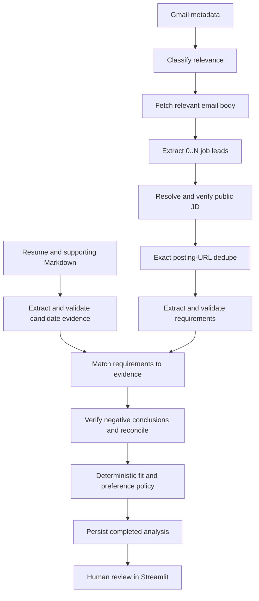

# AI Job Search Agent

A local, human-reviewed job-search assistant that turns job-alert emails into an evidence-grounded opportunity queue.

**Portfolio V1:** implemented in Python and Streamlit, with Gmail ingestion, bounded JD resolution, structured candidate/job analysis, deterministic scoring, and durable SQLite state. This repository documents the implementation and small component benchmarks; it does not claim a production deployment or production-level model accuracy.

## Problem and product value

Job-alert emails provide leads, but reviewing them still requires opening links, finding a usable job description, interpreting requirements, comparing them with a candidate's actual background, and deciding what deserves attention. Repeating this workflow is slow and makes the reasoning difficult to revisit.

The product reduces that review work by producing a persistent queue with requirement-level evidence and visible gaps. The user makes the final decision: **Pass, Save for later, or Pursue**. V1 does not tailor resumes, submit applications, or contact recruiters automatically.

## End-to-end workflow



Not-related messages and normally unverified leads stop before job analysis. Technical failures remain distinct from negative business outcomes and can be retried.

## Architecture and application orchestration

The application decides when to classify, extract, search, fetch, verify, score, and persist. Semantic components return domain objects; ordinary Python code manages the workflow. This is a bounded application-orchestrated agent, rather than an open-ended Search/Reason/Act loop.

| Responsibility | Implementation |
|---|---|
| User interaction | `app.py`, Streamlit, `job_agent/ui/` |
| UI-facing actions and Agent Run | `job_agent/services/` |
| Candidate-to-opportunity workflow | `job_agent/workflows/` |
| Semantic interpretation | `job_agent/agents/` |
| Gmail and model access | `job_agent/integrations/`, `job_agent/llm/` |
| Search and HTTP retrieval | `job_agent/search/`, `job_agent/web/` |
| Fit and pursuit policy | `job_agent/scoring/` |
| SQLite transactions and repositories | `job_agent/storage/` |

Provider-neutral boundaries include `EmailSource`, `search_web()`, and a shared OpenAI-compatible generation client. The current live provider is Qwen / Alibaba Model Studio; the OpenAI Python SDK supplies the compatible client. The project uses direct application code without LangChain or LangGraph.

### LLMs versus deterministic code

LLMs interpret email relevance, extract job candidates, verify fetched JDs, extract and ground candidate evidence and requirements, judge requirement support, verify negative conclusions, and extract grounded job attributes.

Python handles domain contracts, URL validation, bounded retrieval, IDs, account-scoped processed-email state, exact posting-URL dedupe, score arithmetic, preference policy, database constraints, and workflow control. Numerical fit is not generated by a model.

## Discovery: metadata first, then 0..N candidates

Gmail uses installed-app OAuth with read-only scope. The source lists recent messages and retrieves sender, subject, and snippet before classification. Only related messages require the full body and extracted HTML links. Extraction can return zero, one, or multiple `JobCandidate` leads per email.

A lead is not a verified job posting. That distinction prevents an incomplete email preview from becoming the basis of candidate/job analysis.

Processed messages are scoped by `account_key + message_id`. V1 maintains one active Gmail account; a replacement token is installed only after the new account has authorized and its identity is verified. Candidate evidence and opportunity history remain intact when the inbox changes.

## JD Resolution and the architecture decision

Current routing is source-aware:

```text
LinkedIn / Indeed -> skip provider URL -> bounded Web Search
Other source      -> try source URL once -> bounded Web Search if needed
```

The search stage issues one application-level search operation using company, full title, and optional location. The current Qwen adapter requests its hosted Responses API `web_search` tool. Returned candidates retain provider ranking after conservative URL cleanup and dedupe.

The application considers at most 30 results, attempts at most 15 page fetches, and processes batches of five. Structural validation removes unusable pages; semantic verification checks lead consistency and sufficient JD completeness. Processing stops on the first adequate match. The search prompt prefers employer/ATS postings, but downstream acceptance is semantic consistency and completeness, not a strict official-domain requirement.

The design changed after a live sanity check of four LinkedIn/Indeed provider links produced **0/4 analysis-ready results** through the then-current direct-fetch path. This was a test of an acquisition assumption, not an overall system success-rate benchmark. The result motivated the bounded-search redesign. [Architecture decision and historical protocol](docs/jd-resolution-decision.md).

`VERIFIED`, `UNVERIFIED`, and technical failure remain separate outcomes. An inaccessible individual result can be skipped; a failed search or semantic verification operation remains a retryable technical failure.

## Candidate Evidence Extraction

The user uploads a Markdown resume and optional supporting project documents. The evidence extractor produces structured units containing a claim, source document, source section, quoted source text, and evidence type. Validation checks provenance and semantic grounding before evidence enters the active candidate corpus.

One managed resume is active at a time; supporting materials accumulate. A replacement resume becomes active only after its file and validated evidence are committed successfully. Old evidence remains available to hydrate historical analyses.

Exact quote fidelity and semantic grounding are separate checks. A paraphrased claim can be semantically supported while its quote fails an exact substring check. The evidence benchmark also exposed missed capability evidence in long architecture prose, which can later appear as a false candidate gap.

## Requirement Extraction

A verified JD is converted into requirements with category, strength, source text, and section. Categories cover responsibility, experience, skill, domain knowledge, education, license, certification, and other; strengths are `CORE`, `REQUIRED`, and `PREFERRED`.

The extractor aims to preserve atomicity, OR/equivalency logic, strength language, and grounding while excluding benefits and other noise. A separate validator checks extracted requirements before matching. Structural errors are tracked separately from semantic coverage: a bundled or incorrectly split requirement can cover the right concepts while distorting later scoring.

## Requirement–Evidence Matching

The matcher sees each validated requirement and the complete active evidence corpus. V1 uses no embedding Top-K prefilter, avoiding gaps introduced by dropping complementary evidence in this small corpus.

Support levels are `STRONG`, `PARTIAL`, `WEAK`, and `NOT_CLEARLY_SUPPORTED`; linked evidence is marked direct or adjacent, with explanations. Multiple evidence units can jointly establish support. A second pass verifies high-risk negative conclusions, followed by reconciliation into one finalized mapping per requirement.

`NOT_CLEARLY_SUPPORTED` means insufficient evidence in this corpus, not proof that the person lacks the capability. The UI makes the requirement, support reasoning, evidence claim, document, and original source text inspectable.

## Deterministic scoring and preference layer

Requirement Fit is a weighted mean of finalized support values, multiplied by 100 and rounded to one decimal:

| Support | Value | Requirement strength | Weight |
|---|---:|---|---:|
| STRONG | 1.00 | CORE | 1.30 |
| PARTIAL | 0.65 | REQUIRED | 1.10 |
| WEAK | 0.30 | PREFERRED | 0.70 |
| NOT_CLEARLY_SUPPORTED | 0.00 | | |

It is a prototype policy signal, not an interview or offer probability. Base pursuit tiers use thresholds of 85, 70, and 55. Location, work mode, industry, company size, and employment type are evaluated separately as match, mismatch, or unknown. Mismatches can downgrade pursuit priority by at most one tier; they do not alter Requirement Fit. Compensation is excluded from V1 preferences.

Strong-match and main-gap summaries are deterministic projections of finalized mappings, rather than another model judgment.

## Persistence, deduplication, and fault isolation

Verified posting URLs are exact durable dedupe keys. V1 does not claim cross-site semantic identity resolution. Completed opportunities, requirements, and mappings are persisted atomically, as historical snapshots; a user decision updates the decision field rather than rewriting the original analysis.

Successful opportunities are saved as they complete. One candidate failure does not erase completed work, and a partly failed multi-candidate email remains retryable. The email is marked processed only after its candidate workflow has completed without technical failures; persisted posting dedupe prevents repeated analysis of already completed opportunities.

SQLite migrations preserve local history and evidence references. The public repository contains no prepopulated database or personal candidate documents. [Persistence and migration design](docs/persistence-design.md).

## Evaluation and representative results

Component benchmarks isolate semantic stages from upstream errors. They are small curated behavioral/regression sets, not production accuracy estimates. Human-reviewed Gold and alignments are preserved; historical names/status markers were normalized for publication after the author confirmed review completion.

| Component | Evidence | Interpretation |
|---|---|---|
| Discovery | 8 sanitized Gmail-derived cases; 8/8 classification; 15/15 candidate precision/recall; title 14/15; company 15/15; provider-ID 12/12 | Current small regression baseline. Location review remains recorded as pending. |
| Evidence extraction | Four source documents; recorded baseline has 56/72 verbatim quotes | Quote fidelity is distinct from semantic correctness; long-prose recall is a visible limitation. |
| Requirement extraction | Eight curated JDs; reviewed alignments report 106/109 Gold concepts covered, 99.0% prediction validity precision, 97.2% recall, 98.1% semantic F1 | Semantic concept coverage does not imply structurally correct atomic requirements. |
| Matching v2 | Fixed 120 evidence units, 32 requirements, 32 reviewed Gold mappings | Baseline and PromptFix1 both score 20/32 exact support accuracy (62.5%). Recomputed macro F1: 0.539 and 0.441 respectively. No aggregate improvement is established. |

The targeted verifier change corrected the observed MREQ029 clinical-domain regression, but first-pass matcher labels also varied between runs. These results do not establish positive aggregate verifier lift or a causal improvement from that change.

The matching V1 evaluation cycle is closed. Frozen inputs and Gold remain available for regression; changing annotation policy or inputs should create a new benchmark version. The expanded Job Agent evidence Gold references an exact historical README snapshot that is absent from this local export; a pre-cleanup README snapshot is included for context, with the mismatch documented rather than silently treated as the same source.

[Evaluation index and provenance](evals/README.md) · [Discovery](evals/discovery/README.md) · [Evidence extraction](evals/evidence_extraction/README.md) · [Requirement extraction](evals/requirement_extraction/README.md) · [Matching](evals/matching_evaluation/README.md).

## Limitations and production next steps

Implemented V1 is a local single-user prototype. Public-page retrieval can fail on protected or JavaScript-only sites, search is bounded, and exact URL dedupe misses cross-site duplicates. Extraction can miss facts or lose atomic/logical structure; matching can inflate strong support by losing material qualifiers. Scoring weights and tiers have not been calibrated to actual user decisions.

It has no cloud deployment, multi-tenant isolation, production observability, exhaustive cost/latency monitoring, autonomous applying, or resume tailoring. Component results do not establish end-to-end user value or production quality.

Production next steps would be held-out and repeated-run evaluation, end-to-end error-propagation testing, user value measurement against a manual-review baseline, calibration of ranking policy, better source attribution, and operational/privacy controls if deployment beyond local use is justified. These are future proposals, not implemented capabilities.

## Local setup

Run from the repository root with Python 3.11 or newer:

```bash
python3 -m venv .venv
source .venv/bin/activate
python -m pip install -r requirements.txt
cp .env.example .env
```

Fill in `DASHSCOPE_API_KEY`, `DASHSCOPE_BASE_URL`, `GENERATION_MODEL`, and `SEARCH_MODEL` in `.env`; keep `WEB_SEARCH_PROVIDER=qwen`. Choose an endpoint and models supported by your own Alibaba Model Studio account/region, including Responses API web search for the search model. The example intentionally supplies no credentials or assumed universally available model.

For Gmail, enable the Gmail API in your Google Cloud project, configure an installed/desktop OAuth client and consent access for your account, and save its downloaded client JSON as `data/private/google_credentials.json`. The UI requests `https://www.googleapis.com/auth/gmail.readonly` and stores authorization locally as `data/private/gmail_token.json`. Complete authorization through the UI before running the agent.

Credentials and tokens stay local, but model operations send relevant email content, candidate document text, and job text to the configured provider. Review that boundary before using real personal data.

```bash
python -m streamlit run app.py
```

The default Gmail window is the previous hour, capped at 200 messages. Optional overrides are `JOB_AGENT_GMAIL_LOOKBACK_HOURS` or `JOB_AGENT_GMAIL_LOOKBACK_DAYS` (choose one), `JOB_AGENT_GMAIL_MAX_MESSAGES`, and credential/token path variables shown in `.env.example`.

The app initializes local SQLite state. Upload a Markdown resume, optional supporting Markdown, and preferences through onboarding. Historical state and uploads remain under ignored `data/`.

Optional CLI helpers, run from the root:

```bash
python scripts/run_candidate_upload.py /path/to/document.md
python scripts/run_candidate_profile_ingestion.py /path/to/document.md
```

The first saves a source through the upload boundary; the second also invokes extraction/validation and writes local candidate state. They are optional backend helpers; the UI is the supported product workflow.

## Verification and evaluation runs

```bash
python -m pytest -q
python evals/verify_artifacts.py
```

The formal suite uses synthetic fixtures and temporary databases. Artifact verification is offline and checks frozen hashes, input counts, IDs, and recorded matching metrics; it makes no model calls. Live evaluation commands are documented in each component README and require provider credentials, network access, and billable API calls. New runs write ignored output files and do not overwrite committed canonical evidence by default.

## Demo and repository map

No screenshots or recorded demo are included in this V1 export. Run the local UI to inspect onboarding, the opportunity queue, and requirement-to-evidence detail. No fabricated product screenshots are presented.

```text
app.py                       Local Streamlit product
job_agent/                   Application/domain/provider implementation
tests/                       Offline regression tests
scripts/                     Optional candidate-source CLI helpers
docs/                        Architecture decisions and durability design
evals/                       Four component benchmarks and safe canonical runs
.env.example                 Local configuration template
requirements.txt pytest.ini  Setup and test collection
```

This portfolio demonstrates a concrete product boundary, testable AI components, a revised acquisition architecture based on live evidence, inspectable semantic judgments, and deterministic state/policy around model behavior.
